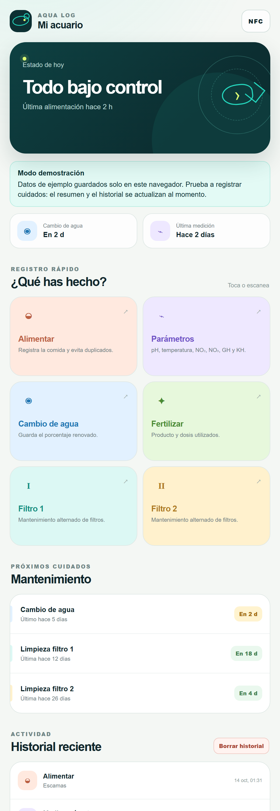

<div align="center">

# 🐠 Acuario NFC

**Registro y mantenimiento inteligente del acuario con un simple toque de móvil**

Toca una etiqueta NFC junto al acuario y el cuidado queda registrado al momento, sin abrir ninguna app.

[](https://acuario-nfc.vercel.app/?demo=1)




</div>

<details>
<summary>🇬🇧 <b>English summary</b></summary>

<br>

**Acuario NFC** is a web app to log aquarium care (feeding, water changes, fertilizing, filter maintenance and water parameters) by tapping NFC tags with your phone. Taps trigger iOS Shortcuts / Android MacroDroid automations that call a server endpoint, so the event is recorded without opening the app, and duplicate feedings on the same day are blocked. Built with Next.js 16, React 19, TypeScript and Supabase (PostgreSQL with Row Level Security), installable as a PWA and deployed on Vercel.

</details>

---

## 💡 La idea

Llevar el control de un acuario (cuándo se alimentó a los peces, cuándo se cambió el agua, cómo están los nitritos…) suele acabar en notas olvidadas. **Acuario NFC** lo resuelve pegando etiquetas NFC junto al acuario: al acercar el móvil, el cuidado se registra automáticamente y llega una notificación de confirmación.

## ✨ Funcionalidades

- 📲 **Registro con NFC sin abrir la web**: integración con *Atajos* (iPhone) y *MacroDroid* (Android) mediante el endpoint `POST /api/scan`.
- 🍽️ **Alimentación**: registra la primera toma del día y bloquea una segunda en el mismo día natural (zona `Europe/Madrid`) para evitar sobrealimentar.
- 💧 **Cambios de agua**, 🌿 **fertilización** y 🔧 **mantenimiento de dos filtros**, cada uno con su propia etiqueta.
- 🧪 **Parámetros del agua** (temperatura, NO₂, NO₃…) mediante formulario rápido.
- 📊 **Panel general**: estado de hoy, próximos cuidados e historial reciente.
- 👀 **Modo demostración** (`?demo=1`): datos de ejemplo guardados solo en el navegador para probar la app sin cuenta ni base de datos. También se activa solo si la base de datos no está disponible.
- 🔗 **Configuración NFC integrada**: la app genera los siete enlaces listos para grabar en las etiquetas.
- 📱 Instalable como **PWA** en el móvil.

## 🧱 Arquitectura

```
Etiqueta NFC ──> Atajos / MacroDroid ──> POST /api/scan ──┐
                                                          ├──> Next.js (Vercel) ──> Supabase (PostgreSQL)
Navegador ──────> Panel web (React) ──> /api/events ──────┘
```

- **Privacidad por diseño**: cada acuario se identifica con un ID aleatorio incluido en su URL privada.
- **Seguridad**: la tabla tiene *Row Level Security* activado sin políticas públicas; solo el servidor accede con la clave `service_role`, que nunca llega al navegador.

## 🚀 Puesta en marcha

1. Crea un proyecto gratuito en [Supabase](https://supabase.com) y ejecuta [`supabase/schema.sql`](Acuario-NFC-Externo/supabase/schema.sql) en el **SQL Editor**.
2. Despliega la carpeta [`Acuario-NFC-Externo`](Acuario-NFC-Externo) en [Vercel](https://vercel.com).
3. Añade las variables de entorno `SUPABASE_URL` y `SUPABASE_SERVICE_ROLE_KEY`.
4. Abre la web, entra en **NFC** y graba los enlaces en tus etiquetas.

Para desarrollo local:

```bash
cd Acuario-NFC-Externo
npm install
npm run dev
```

## 📁 Estructura

```
Acuario-NFC-Externo/
├── app/
│   ├── aquarium-app.tsx      # Interfaz principal (panel, registro rápido, historial)
│   ├── api/
│   │   ├── scan/route.ts     # Endpoint para las automatizaciones NFC
│   │   ├── events/route.ts   # Lectura y escritura del historial
│   │   └── _lib/aquarium.ts  # Lógica compartida y acceso a Supabase
│   ├── manifest.ts           # Manifiesto PWA
│   └── layout.tsx
└── supabase/schema.sql       # Esquema de la base de datos
```

---

<div align="center">
Hecho por <a href="https://github.com/diegotraski">Diego Trascasa García</a>
</div>
